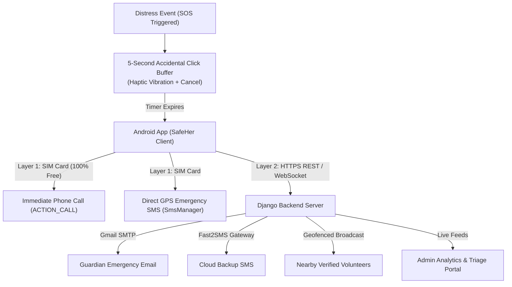

# 🛡️ SafeHer — Intelligent Women Safety & Emergency Response Ecosystem


**SafeHer** is an end-to-end, multi-tier women's safety ecosystem comprising an **Android application** and a **Django REST backend** with real-time analytics and emergency dispatch. It bridges the gap between personal emergency contacts, verified community volunteers, and institutional emergency authorities.

---

## 🌟 Key Features

### 1. 🚨 3-Tier Progressive Emergency Escalation
* **Tier 1 (Primary Guardian)**: Immediately dispatches a direct cellular phone call, GPS tracking SMS, email, and push notification to the user's primary emergency contact.
* **Tier 2 (Secondary Circle & Friends)**: Automatically activates if the primary contact does not respond within a timed escalation window (45–60s).
* **Tier 3 (Verified Community Volunteers)**: Broadcasts a localized distress mission to background-verified community volunteers located near the victim's live coordinates.

### 2. 🛡️ Accidental Click Defense System
* **5-Second Countdown Buffer**: Prevents false alarms from pocket touches or accidental taps with haptic pulse vibrations and an instant one-tap **Cancel SOS** option.
* **"I Am Safe" False Alarm Resolution**: If an alert is triggered accidentally, the user can resolve it with one tap, immediately notifying contacts and halting volunteer dispatch.

### 3. 🪪 Volunteer ID Proof Verification Gate
* **Role-Based Gating**: Women and guardians register and receive immediate, friction-free access to safety tools.
* **Vetting for Responders**: Community volunteers must upload a valid government ID proof (Aadhaar, Driving License, Voter ID, or Passport). Their accounts are gated with `pending` status until reviewed and approved by an admin in the Web Portal.

### 4. 📞 Offline-First Helpline Directory
* Built-in verified national helpline numbers (`112`, `1091`, `181`, `100`, `108`, `1930`, `1098`) accessible **even without internet or cellular data**.
* One-tap calling via native Android dialer without memory strain during panic.

### 5. 📊 Real-Time Admin Analytics & Triage Dashboard
* Live Web Dashboard featuring interactive **Chart.js** data visualizations:
  * **Incident Status Donut Chart**: Breakdown of Active, Resolved, and Cancelled incidents.
  * **User Roles Bar Chart**: Distribution of Women, Guardians, Volunteers, and Admins.
  * **Peak Risk Hours Bar Histogram**: 24-hour incident distribution with intensity-coded hazard levels.
* Triage queue for pending volunteer ID document inspection, approval, and rejection.

### 6. 🎙️ Digital Evidence Vault & Incident Chat
* Captures encrypted background audio recordings during distress for legal investigation.
* Provides a synchronized multi-party emergency chat room connecting the victim, guardians, and assigned volunteer.

---

## 🏗️ System Architecture



---

## 🛠️ Tech Stack

* **Mobile App (Android)**: Kotlin, Jetpack (ViewBinding, Coroutines, Lifecycle), Retrofit 2, OkHttp 3, Google Play Services Location, Google Maps SDK, Material Design 3.
* **Backend (Server)**: Python 3.12+, Django 5+, Django REST Framework, SimpleJWT, Daphne ASGI (WebSockets), SQLite / PostgreSQL.
* **Frontend (Admin Dashboard)**: HTML5, CSS3 (Cyberpunk/Neon Dark Theme), Vanilla JavaScript, Chart.js.
* **Integrations**: Gmail SMTP, Fast2SMS API, Firebase Cloud Messaging (FCM).

---

## 🚀 Getting Started

### Prerequisites
* **Android Studio** Hedgehog or newer (JDK 17+)
* **Python** 3.10+ and `pip`
* **Git** installed on your system

---

### Backend Setup (Django)

1. **Clone the repository:**
   ```bash
   git clone https://github.com/your-username/SafeHer.git
   cd SafeHer/backend
   ```

2. **Create and activate a virtual environment:**
   ```bash
   # Windows
   python -m venv venv
   .\venv\Scripts\activate

   # Linux / macOS
   python3 -m venv venv
   source venv/bin/activate
   ```

3. **Install dependencies:**
   ```bash
   pip install -r requirements.txt
   ```

4. **Configure Environment Variables:**
   ```bash
   cp .env.example .env
   ```
   *Edit `.env` with your preferred settings (e.g. Gmail App Password, Fast2SMS key).*

5. **Run migrations and start server:**
   ```bash
   python manage.py migrate
   python manage.py runserver 0.0.0.0:8000
   ```
   *Access the Admin Portal at: `http://127.0.0.1:8000/admin-panel/dashboard/`*

---

### Android Setup (Client)

1. Open **Android Studio**.
2. Select **Open an Existing Project** and navigate to the `SafeHer/android` folder.
3. Allow Gradle to sync dependencies.
4. Set your backend IP / URL in `com.womensafety.utils.Constants.kt` or `ApiClient.kt`:
   ```kotlin
   const val BASE_URL = "http://10.0.2.2:8000/api/" // For Android Emulator
   // OR use your local Wi-Fi IP (e.g., http://192.168.1.X:8000/api/) for physical device
   ```
5. Click **Run (`Shift + F10`)** to install and run the app on your emulator or connected device.

---

## 📂 Project Structure

```
SafeHer/
├── android/                   # Native Android application (Kotlin)
│   ├── app/src/main/
│   │   ├── java/com/womensafety/
│   │   │   ├── data/          # Models, API Service, Repositories
│   │   │   ├── ui/            # Activities (Auth, SOS, Chat, Helplines)
│   │   │   └── utils/         # Helpers (Location, Voice, Network)
│   │   └── res/               # Layouts, drawables, navigation, styles
│   └── build.gradle.kts
│
├── backend/                   # Django REST Framework Backend
│   ├── accounts/              # CustomUser, Auth, Verification Gating
│   ├── admin_panel/           # Admin Dashboard views, URLs, templates
│   ├── alerts/                # SOS Alerts, Escalation Engine, SMS/Call services
│   ├── community/             # Volunteers, Missions, Helpline Directory
│   ├── location/              # Geofencing, GPS Tracking, Danger Zones
│   ├── templates/             # admin_dashboard.html
│   └── manage.py
│
├── .gitignore                 # Root Git Ignore rules
├── requirements.txt           # Python dependencies
└── README.md                  # Project documentation
```

---

## 🔒 Security & Privacy

* **Zero Hardcoded Credentials**: All passwords, API tokens, and secret keys are stored exclusively in environment variables.
* **Strict Ownership Validation**: SOS alerts can only deliver notifications to contacts explicitly authorized and saved by the authenticated user.
* **Accidental Click Protection**: 5-second cancel buffer ensures user privacy and prevents emergency false alarms.

---

## 📄 License
This project is licensed under the MIT License — see the LICENSE file for details.
